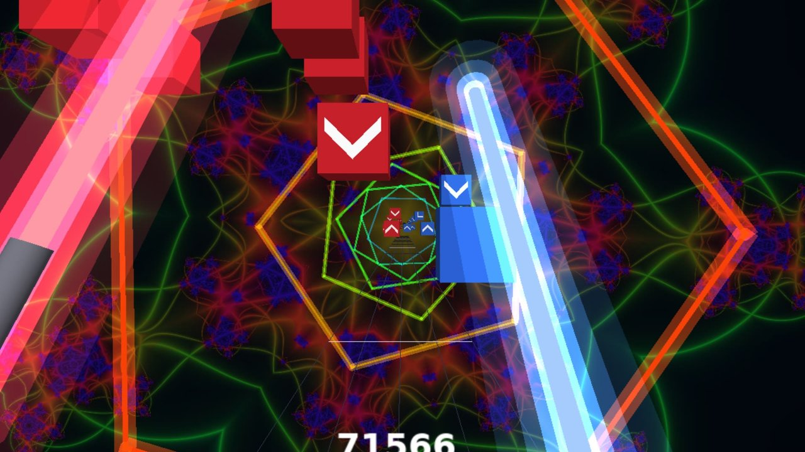
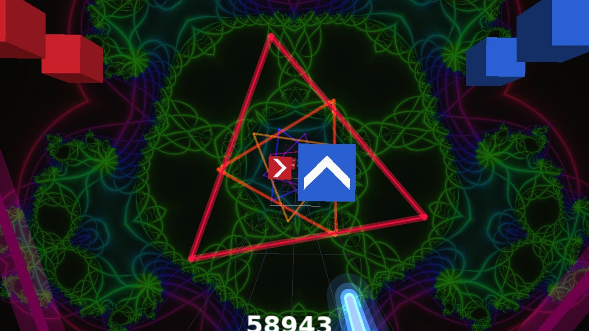
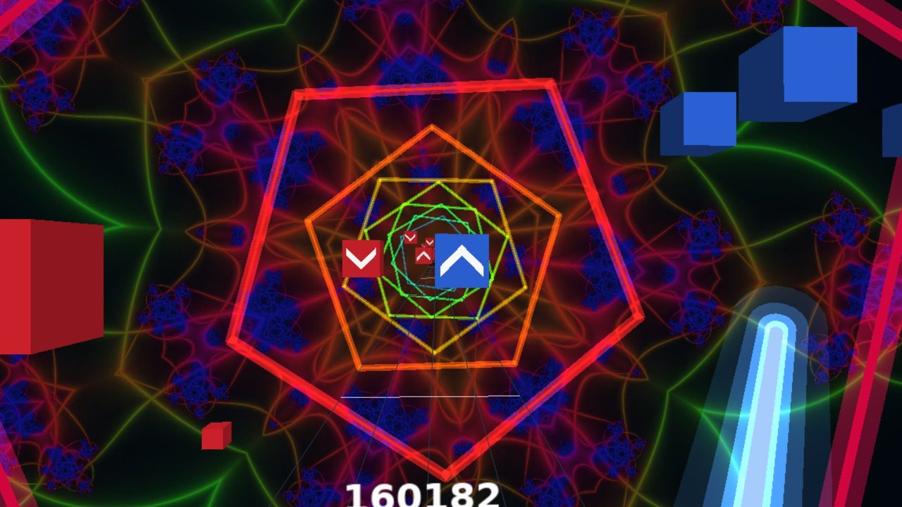
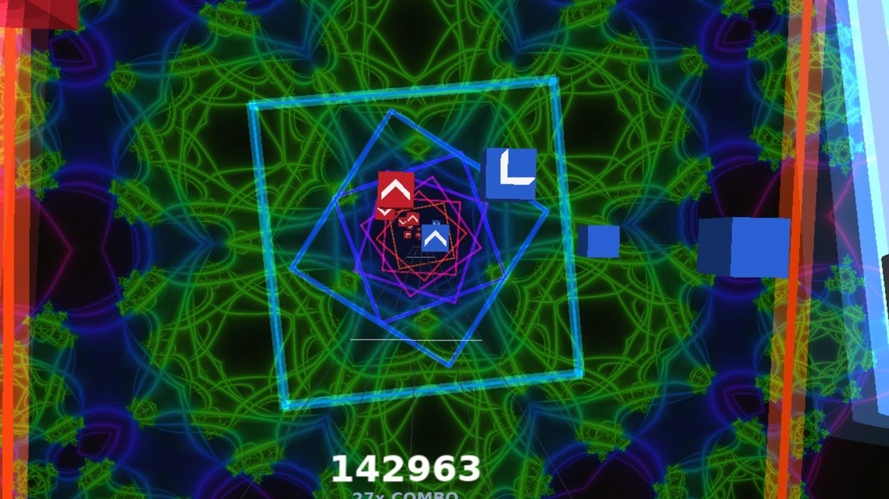

# Pulse

A Beat Saber-style rhythm game for the jailbroken PS5 with PS VR2 and Sense controllers. Give it any MP3 and it
analyses the song (tempo, beats, build-ups and drops) and cuts Easy, Medium, Hard and Extreme note maps from it,
on the console, in a few seconds. The neon backgrounds and bloom follow the music.

| | |
|---|---|
|  |  |
|  |  |

Screenshots from the headset view on a PS5 (scaled down from the 1080p captures).

https://github.com/user-attachments/assets/8df9ad8c-bab9-4f40-aa5a-029f4efdc64f

https://github.com/user-attachments/assets/440491c6-80c6-482c-9823-6607f0f54336

Some videos to give you an idea of how it looks / plays.

Title ID `PPSA99993`. Needs a jailbroken PS5 running ShadowMountPlus (or another way to mount native app folders).

## Install

No release has been published yet: it is still in testing. Until then, build the zip yourself with `bash ps5/release.sh` (see Building).

1. Copy the `PPSA99993` folder from the release zip to your mounted app location (for example `/mnt/usb0/PPSA99993`).
2. Start the jailbreak and mount it as usual, then launch Pulse from the home screen.

The release carries one generated demo song, "Neon Run". It makes no network connections and does not ask for any
extra privileges; the catalog's release scan (`python3 -m catalog scan --zip <zip> PPSA99993`) finds no way out of the
sandbox in it. Development builds (`ps5/build.sh`) can also send their log to a PC.

## Adding your own music

Copy MP3s (in any folders) into `PPSA99993/assets/songs/`, then choose **Options, Rescan Music** in the game: new songs appear without
restarting. No list file is needed: the game opens the folder directly (the console refuses the usual way of listing a folder, so the
game uses a lower-level call that works; the log says `listed through open(dir)`). Songs are read by their ID3 tags (artist, title, cover
picture) and fall back to the file name. Tracks over about 17 minutes are skipped. Maps are cached in `/download0/cache` the first
time a song is played.

Fallback: if a console or firmware ever refuses listing too, the game reads `assets/songs/index.txt` (one path per line, relative to that
folder; backslashes, `./` and full Windows paths are accepted). Make it with `find . -name '*.mp3' > index.txt` (Linux, macOS), `dir /s /b /a-d *.mp3
> index.txt` (Windows cmd) or `python3 tools/make-index.py <path to assets/songs>`.

## Playing

Stick or D-pad and the trigger navigate the menus (Circle or Square goes back; Options or Triangle pauses), so either Sense controller works on its own. If the menu starts off to one side, look straight ahead and press
R3 to centre it (a hint shows until you do). **How to play** in the title menu explains the rules; in short:

- **Easy**: dots, cut in any direction, or just touched with the correct saber (the one matching the block's colour).
- **Medium**: lines. Cut along a line either way for full points, or across it for half. The combo is never broken
  by direction.
- **Hard**: arrows. Cut the way the arrow points; the wrong way scores nothing and breaks the combo.
- **Extreme**: Hard with more blocks, pairs and faster runs.

A cut scores up to 115 times the multiplier (x2 at 2 in a row, x4 at 6, x8 at 14); a miss or a bad cut resets it. The rank is out of 100, half the share of blocks hit and half the score, so a few misses do not sink it: S 90 and up, A 80, B 70, C 50, D 40, E 30, and F below that.
The saber is longer on the easier levels for more reach (1.3 m Easy, 1.2 Medium, 1.1 Hard, 1.0 Extreme). Triangle on the song list picks a new pattern for a song. Options has colour-blind and high-contrast palettes, a
hand swap, the background (off, flat or 3D), the play area (normal 2.0 m, medium 1.7 m or small 1.4 m wide, which bring the lanes, rows and blocks
closer together and make the game easier: shorter players, children, seated play, tight spaces), seated mode (the field drops to chair height and the rows sit closer, so no reach above the head), the saber glow (off leaves bare blades lit only by the bloom), the button hints (menu footers and the pause reminder at the start of a song); and Hands (both, left only, right only) for one-handed
play, which generates maps for one hand (its three lanes, every block its colour, longer rests between swings, no pairs) with their own
scores. The PS5 itself still wants both Sense controllers connected and charged before a VR title will run; the spare one can be put down and Pulse plays with the other. The play area re-centres on where you stand at the start of each song.

Demo (on the title screen) picks a random song and level and lets the game play itself; any button stops it: the bot's hands bounce to the beat, swing in arcs,
lean the blade into each cut and miss a few, so you can show it off without holding the controllers. Demo runs keep no score and cannot be taken over.
When the two blades touch there are sparks, a clink and a buzz in both controllers, harder the faster they met.

## Building

Developers and AI assistants: start with `AGENTS.md` (how it works, coordinate spaces, console hazards, how to build another
PS VR2 game on this base). The code comments are written in a compact contract style for that purpose.

Needs the PS5 OpenGL SDK, the native app boilerplate and the payload SDK checked out as `ps5/build.sh` describes.

- `bash ps5/build.sh` builds `build/ps5/dist/PPSA99993` (a development build also sends its log to this PC, see `tools/logsrv.py`).
- `bash ps5/release.sh` builds the shareable zip, with the demo song and no log address.
- `make play` runs the desktop version (SDL, keyboard or gamepad), `make test` the unit tests.
- Art: `tools/makeart.py`; demo song: `tools/makedemo.py` (both need a venv with numpy and pillow).

## Thanks

Pulse stands on a lot of other people's work:

- [ps5-opengl](https://github.com/blackbearreloaded/ps5-opengl) and the [native app boilerplate](https://github.com/blackbearreloaded/ps5-native-app-boilerplate), by BlackBearReloaded: OpenGL 4.6 on the PS5 and the app packaging. Without them there is no picture.
- The [PS5 Payload SDK](https://github.com/ps5-payload-dev/sdk) and everyone behind the PS5 jailbreak, for the toolchain and the way in.
- [PS5VR](https://github.com/theghostonline/PS5VR), by theghostonline: the PS VR2 headset, Sense controller and audio output handling that `platform/vr_ps5.cpp` follows.
- [Mesa](https://www.mesa3d.org/) and the OpenGNM projects, which ps5-opengl is built on.
- ShadowMountPlus, for mounting the app from a USB stick.
- The [PS5 homebrew catalog](https://github.com/blackbearreloaded/ps5-homebrew-catalog), also by BlackBearReloaded, for somewhere to list it.
- [minimp3](https://github.com/lieff/minimp3) by lieff, [stb_image](https://github.com/nothings/stb) by Sean Barrett, and the DejaVu fonts (Bitstream Vera).

## Contributing

It is a hobby project and contributions are welcome: see `CONTRIBUTING.md`.

## Licence

GPL-3.0-or-later, because the PS5 OpenGL runtime it links is. See `LICENSE` and `THIRD_PARTY_NOTICES.md`.
